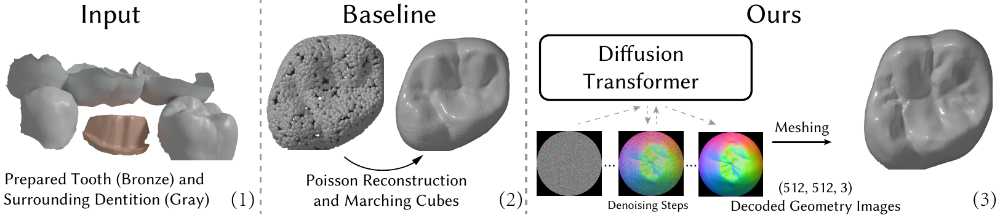

# CrownFusion

- Project page: <https://crownfusion.github.io/>
- Paper: <https://doi.org/10.1007/978-3-032-38186-6_44>
- Dataset: [FDI 16 Crown Dataset](https://doi.org/10.11583/DTU.35039497) on DTU Data (CC BY-NC-SA 4.0)



Training code for **CrownFusion**, a diffusion transformer (SiT backbone) that generates dental crowns as
geometry images ("omages"), conditioned on the surrounding dentition. The pipeline has four stages:

```
create_omages_dataset.py  ->  train_ae.py  ->  encode_omages.py  ->  train.py
   (meshes -> omages)        (train AE)       (omages -> latents)   (train SiT)
```

## Setup

```bash
bash setup_environment.sh        # creates ./omage_env (Python 3.11, CUDA 11.8)
source omage_env/bin/activate
```

A CUDA GPU is required. The autoencoder uses the FLUX VAE (`black-forest-labs/FLUX.1-schnell`, `vae/`
subfolder); accept its terms on Hugging Face and run `huggingface-cli login` before the first run.

## Data layout

The FDI 16 Crown Dataset is available on DTU Data: <https://doi.org/10.11583/DTU.35039497>. It has 11,513 cases
(9,513 train / 1,000 val / 1,000 test). Download `CrownFusion.zip` (23.5 GB) and extract it; it unpacks to
`CrownFusion/`, which is the dataset root with the layout below. File formats are described in `readme.txt` inside
the archive.

```
<root>/
  train/<id>/  val/<id>/  test/<id>/     # numeric case IDs
      input_points.dat  input_properties.dat  outer_crown.ply
      prep_distance2border.dat  prep_mesh.ply  dentition_mesh.ply
  training.json  validation.json  testing.json    # lists of the IDs per split
```

Only `outer_crown.ply` is read when creating omages; `input_points.dat`, `input_properties.dat`, `prep_mesh.ply` and
`prep_distance2border.dat` are read as conditioning input during AE/SiT training; `dentition_mesh.ply` is only
copied for visualization.

## Pipeline

All paths below are the config defaults; override them with the flags shown.

```bash
DATA=/path/to/CrownFusion     # dataset root (layout above)

# 1. Meshes -> crown omages  (writes ./data/omages/crown_{train,val,test}/<id>.npy)
python create_omages_dataset.py --data-path $DATA --output-dir ./data/omages

# 2. Train the autoencoder (edit configs/ae_config.yaml: data_path, orig_data_path, results_dir)
python train_ae.py --config configs/ae_config.yaml
#    checkpoint: ./results_ae/<run>/checkpoints/checkpoint_epoch_600.pt

# 3. Encode omages into latents  (writes ./data/encoded_omages/)
python encode_omages.py --encode-crown \
    --crown-vae-ckpt ./results_ae/<run>/checkpoints/checkpoint_epoch_600.pt \
    --data-path ./data/omages --orig-data-path $DATA --calculate-scaling-factor

# 4. Train the diffusion model on the latents
python train.py --config configs/SiT_config.yaml \
    --data-path ./data/omages --orig-data-path $DATA \
    --vae-ckpt ./results_ae/<run>/checkpoints/checkpoint_epoch_600.pt
```

`train.py` flags: `--config`, `--data-path`, `--orig-data-path`, `--vae-ckpt`, `--results-dir`, `--wandb`,
`--debug`, `--ckpt` (resume). Multi-GPU: launch with `torchrun --nproc_per_node=N`.

This repository contains training code only. There is no standalone sampling or evaluation script; generated
crowns and Chamfer distances are produced periodically during `train.py` (`logging.sample_every`,
`logging.chamfer_every`), so reported results cannot be reproduced from a saved checkpoint alone.

## Known issues

The issues below were found during a later review of the code with Claude (Anthropic's AI coding agent),
after the experiments for the paper were finished. The original code was written with the help AI coding agents
that were less capable than current ones, and these bugs were not caught at the time.

- **Autoencoder training does not synchronize gradients across GPUs.** `train_ae.py` wraps the model in
  `DistributedDataParallel` but calls `model.module.vae.encode/decode` directly, which bypasses DDP's forward
  pass, so gradients are never all-reduced. In addition, `DistributedSampler.set_epoch` is never called, so each
  rank sees the same shard of the data in the same order every epoch. Only rank 0's weights are saved.
  The AE used in the paper was trained with 2 GPUs under this behavior. It is therefore effectively a
  single-GPU run on about half of the training cases (batch size 2, no reshuffling across epochs), not a
  2-GPU data-parallel run on the full training set. The SiT model was still trained on latents of the full
  training set, and no validation or test data was used for AE training.
  The logged AE train/val losses are also mis-scaled: each rank sums over its own shard but divides by the
  full dataset size.
  The code is left as it was for the paper. Run `train_ae.py` on a single GPU to train on the full training set.
- **Classifier-free guidance only touches 3 of the 16 latent channels** (`SiT.forward_with_cfg`). This is
  inherited from the original DiT/SiT code, which had 4 latent channels. It is what the paper results used.

## Notes for future work

The latent diffusion pipeline has not been hyperparameter optimized. The learning rates, batch sizes, number of
epochs, EMA decay, classifier-free guidance scale, model size (SiT-B/1), the AE schedule and the latent scaling
factor were set once and not tuned, so there is likely performance to be gained from tuning them. The items
under "Known issues" are also natural starting points: fixing the AE's multi-GPU training, and applying
guidance to all latent channels.

## Config keys

`configs/ae_config.yaml`: `results_dir`, `data.data_path` (omages), `data.orig_data_path` (dataset root),
`data.batch_size`, `trainer.max_epochs`, `wandb.*`.

`configs/SiT_config.yaml`:

| Key | Meaning |
|---|---|
| `data.data_path` | omages from step 1 |
| `data.encoded_data_path` | latents from step 3 (used when `data.use_pre_encoded: true`) |
| `data.orig_data_path` | dataset root with `<split>/<id>/` meshes |
| `vae.config_path` | AE architecture config (default `configs/ae_config.yaml`) |
| `vae.ckpt_path` | AE checkpoint from step 2 (replace the `<run>` placeholder) |
| `logging.results_dir` | output directory for runs/checkpoints |

## Weights & Biases

Logging is controlled by `wandb.enabled` in the configs (or `--wandb` for `train.py`). Provide your key with
`export WANDB_KEY=<your key>` or run `wandb login` once beforehand. If `WANDB_KEY` is unset, the explicit login
is skipped. Use `WANDB_MODE=offline` or `WANDB_MODE=disabled` to avoid network access, or leave `wandb.enabled` off.

## Quick end-to-end check

To verify an installation, run the four stages above on a handful of cases: create a directory with
`train/ val/ test/` containing symlinks to ~4 cases each plus matching split JSONs, run step 1 on it, train the
AE for one epoch (`trainer.max_epochs: 1`, `trainer.save_checkpoint_every_n_epoch: 1`, wandb disabled), run step 3
with the resulting checkpoint, and run step 4 with a small `training.epochs` and `logging.ckpt_every: 2`.
Each stage should complete and write its outputs.

## Citation

```bibtex
@inproceedings{ye2026crownfusion,
  title     = {CrownFusion: 3D Dental Crown Generation Using
               Geometry Images and Latent Diffusion},
  author    = {Ye, Johan Ziruo and Yan, Xingguang and Hauberg, S{\o}ren and
               Chang, Angel X. and Zhang, Hao and S{\o}ndergaard, Peter Lempel},
  booktitle = {Medical Image Computing and Computer Assisted Intervention (MICCAI)},
  series    = {Lecture Notes in Computer Science},
  volume    = {16889},
  pages     = {464--474},
  year      = {2026},
  doi       = {10.1007/978-3-032-38186-6_44}
}
}
```

## License and third-party code

See [THIRD_PARTY_NOTICES.md](THIRD_PARTY_NOTICES.md). The SiT code in `sit_utils/` and `transport/` is MIT
licensed (`sit_utils/LICENSE.txt`).

The MIT license in [LICENSE](LICENSE) covers the code only. The FDI 16 Crown Dataset is licensed separately under
[CC BY-NC-SA 4.0](https://creativecommons.org/licenses/by-nc-sa/4.0/) and may only be used for non-commercial
purposes.
